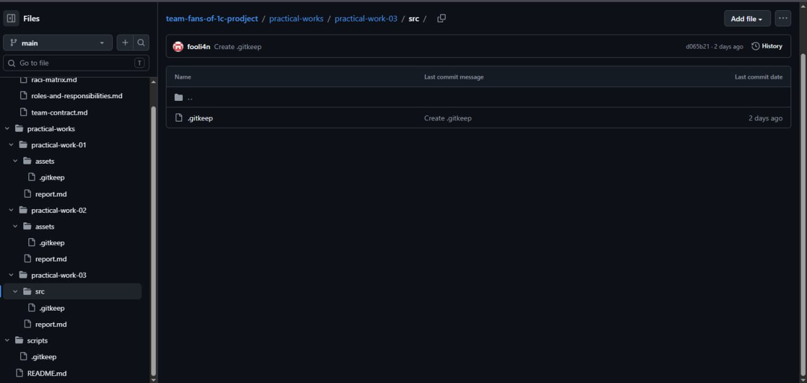
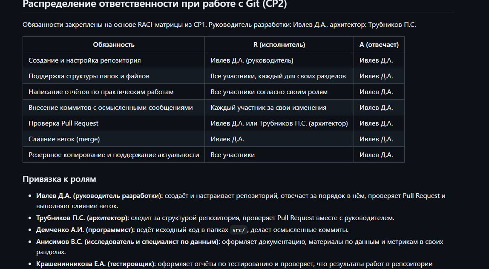
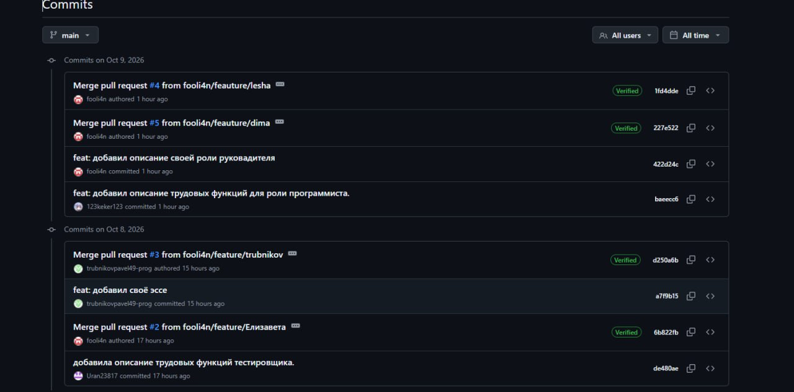
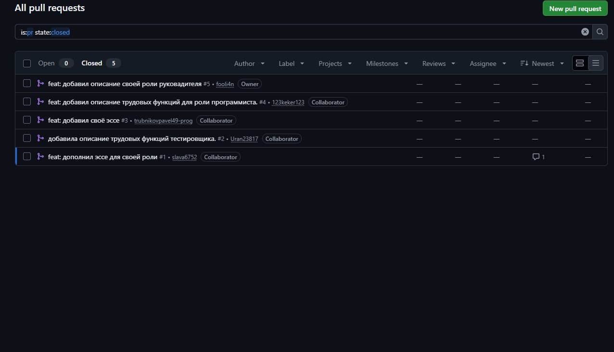

Цель задания: сформировать у обучающихся базовые навыки работы с
репозиторием проекта, освоить принципы хранения и организации
материалов, а также закрепить распределение ответственности через
практическую работу в системе контроля версий.

Списки логинов:
1. https://github.com/fooli4n
2. https://github.com/123keker123
3. https://github.com/trubnikovpavel49-prog
4. https://github.com/slava6752
5. https://github.com/Uran23817

Матрица Raci:
| Этап работы над отчётом | Ивлев Д.А. (руководитель) | Трубников П.С. (архитектор) | Крашенинникова Е.А. (тестировщик) | Анисимов В.С. (спец. по данным) | Анисимов В.С. (исследователь) |
|---|:---:|:---:|:---:|:---:|:---:|
| Создание репозитория, приглашение участников | A/R | C | I | I | I |
| Структура каталогов (docs, practical-works, scripts) | A | R | C | I | I |
| Подтверждение регистрации участников (список логинов) | A/R | I | I | I | I |
| Описание распределения обязанностей по ролям CP1 | A | C | C | R | R |
| История коммитов (скриншоты с авторами) | A | C | R | I | I |
| Pull request и процесс ревью | A | R | R | C | C |
| Итоговое оформление и вычитка отчёта | A/R | C | C | C | C |

Вывод: Система контроля версий Git вместе с GitHub позволяет
команде работать над общим проектом, не мешая друг другу: каждый
участник ведёт изменения в своей ветке, а в основную ветку они попадают
через pull request после проверки. Это снижает риск конфликтов и потери
данных, а любую правку можно просмотреть или откатить.
История коммитов и pull request фиксирует, кто, когда и какие изменения
внёс, поэтому вклад каждого участника виден и поддаётся проверке. Вместе с
распределением ролей и RACI-матрицей это делает командную работу
прозрачной и упрощает контроль результата.
