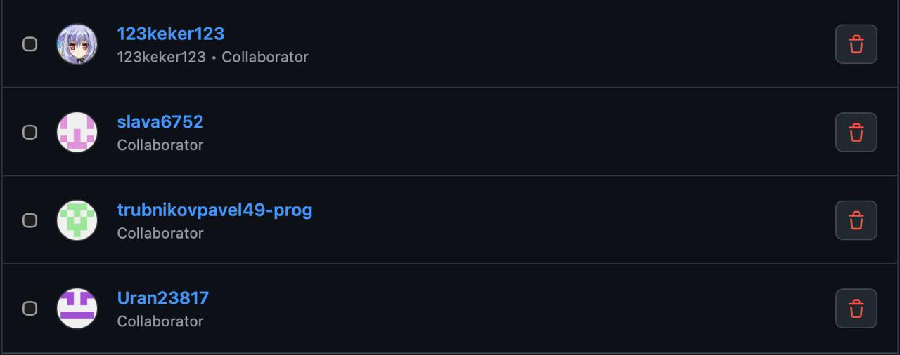

**Цель задания:** сформировать у обучающихся базовые навыки работы с репозиторием проекта, освоить принципы хранения и организации материалов, а также закрепить распределение ответственности через практическую работу в системе контроля версий.

## Список логинов

Каждый член команды самостоятельно создал учётную запись на GitHub (Рисунок 1).

*Рисунок 1 – Список логинов.*

[Ссылка на созданный командный репозиторий](#)

## Дерево папок и файлов

В командном репозитории создана следующая структура (Рисунок 2).

*Рисунок 2 – Дерево папок и файлов.*

## Распределение обязанностей по работе с репозиторием

Работа с командным репозиторием организована в соответствии с ролями, определёнными в CP1 (Рисунок 3).

*Рисунок 3 – Распределение обязанностей по работе с репозиторием.*

## История коммитов

См. Рисунок 4.

*Рисунок 4 – История коммитов.*

## Pull Request

Каждый участник создавал отдельную ветку, вносил в неё изменения, после чего открывал Pull Request для слияния с `main`. Владелиц репозитория проверял изменения и принимал их (Рисунок 5).

*Рисунок 5 – Созданные Pull Request.*

## RACI-матрица

| Этап работы над отчётом | Ивлев Д.А. (руководитель) | Трубников П.С. (архитектор) | Крашенинникова Е.А. (тестировщик) | Анисимов В.С. (спец. по данным) | Анисимов В.С. (исследователь) |
|---|:---:|:---:|:---:|:---:|:---:|
| Создание репозитория, приглашение участников | A/R | C | I | I | I |
| Структура каталогов (docs, practical-works, scripts) | A | R | C | I | I |
| Подтверждение регистрации участников (список логинов) | A/R | I | I | I | I |
| Описание распределения обязанностей по ролям CP1 | A | C | C | R | R |
| История коммитов (скриншоты с авторами) | A | C | R | I | I |
| Pull request и процесс ревью | A | R | R | C | C |
| Итоговое оформление и вычитка отчёта | A/R | C | C | C | C |

**Обозначения:** R (Responsible) — выполняет работу; A (Accountable) — отвечает за результат; C (Consulted) — консультирует; I (Informed) — информируется.

## Вывод

Система контроля версий Git вместе с GitHub позволяет команде работать над общим проектом, не мешая друг другу: каждый участник ведёт изменения в своей ветке, а в основную ветку они попадают через pull request после проверки. Это снижает риск конфликтов и потери данных, а любую правку можно просмотреть или откатить.

История коммитов и pull request фиксирует, кто, когда и какие изменения внёс, поэтому вклад каждого участника виден и поддаётся проверке. Вместе с распределением ролей и RACI-матрицей это делает командную работу прозрачной и упрощает контроль результата.
