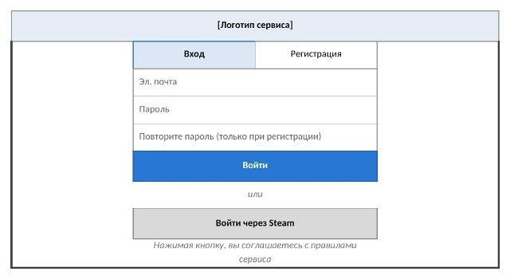
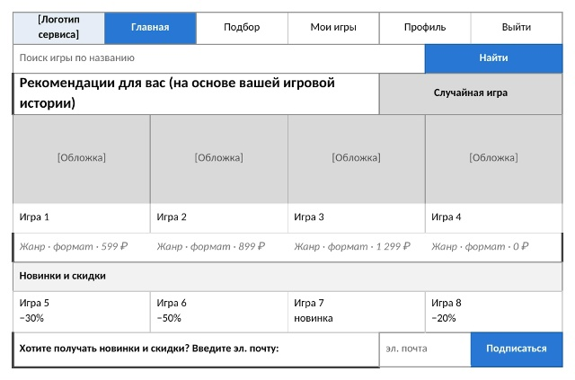
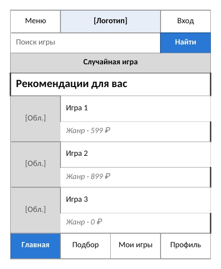
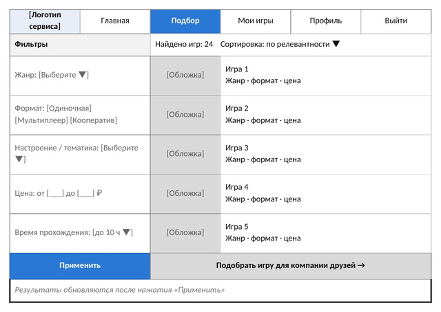
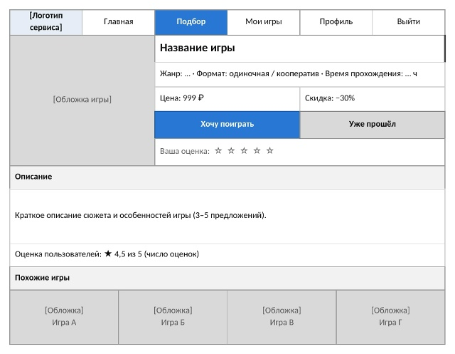
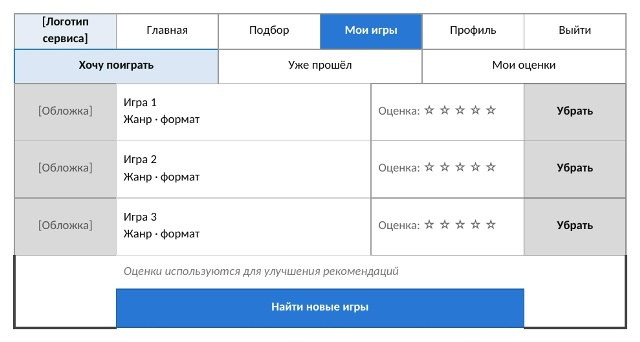
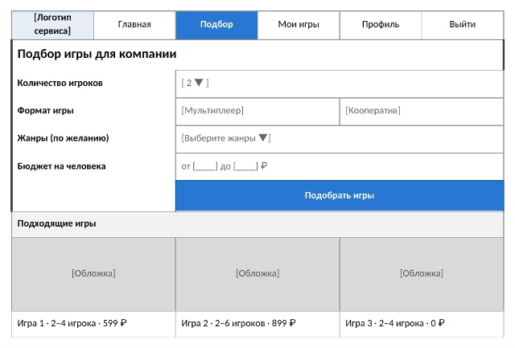
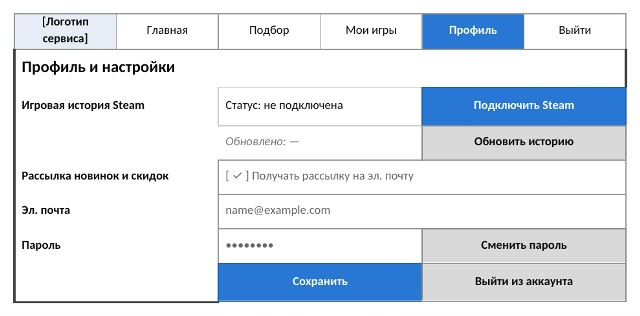
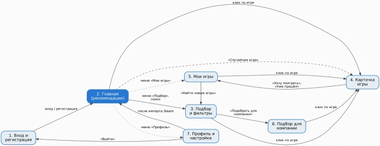

# Самостоятельная работа №5. Разработка интерфейса

## 1. Перечень экранов

Перечень составлен на основе функциональных требований (ФТ) из самостоятельной работы №4.

| № | Экран | Назначение | Требования |
|---|---|---|---|
| 1 | Вход и регистрация | Создание аккаунта и вход в сервис | ФТ-1 |
| 2 | Главная (рекомендации) | Персональные рекомендации, поиск, случайная игра, новинки и скидки, подписка на рассылку | ФТ-3, 11, 12 |
| 3 | Подбор и фильтры | Поиск игр по жанру, формату, настроению, цене и времени прохождения | ФТ-4, 5, 6, 8 |
| 4 | Карточка игры | Описание, жанр, цена, скидка, оценки; добавление в списки и оценка игры | ФТ-9, 10 |
| 5 | Мои игры | Списки «Хочу поиграть» и «Уже прошёл», оценки пользователя | ФТ-10 |
| 6 | Подбор для компании | Подбор игры для совместной игры с друзьями | ФТ-6, 7 |
| 7 | Профиль и настройки | Подключение Steam и импорт игровой истории, управление рассылкой, данные аккаунта | ФТ-1, 2, 12 |

Требование ФТ-13 (удобство на компьютере и телефоне) относится ко всем экранам. Для него дополнительно разработан макет главной страницы для телефона (экран 2а).

## 2. Состав элементов и их назначение

**Экран 1. Вход и регистрация**
- Вкладки «Вход» и «Регистрация» — переключение между режимами.
- Поля «Эл. почта», «Пароль», «Повторите пароль» (только при регистрации) — ввод данных аккаунта.
- Кнопка «Войти» — основное действие.
- Кнопка «Войти через Steam» — быстрый вход и дальнейший импорт игровой истории.

**Экран 2. Главная**
- Верхнее меню (логотип, «Главная», «Подбор», «Мои игры», «Профиль», «Выйти») — навигация по сервису.
- Строка поиска и кнопка «Найти» — поиск игры по названию.
- Блок «Рекомендации для вас» — карточки игр (обложка, название, жанр, формат, цена), подобранные по игровой истории.
- Кнопка «Случайная игра» — быстрый выбор без долгого поиска.
- Блок «Новинки и скидки» — актуальные предложения.
- Поле «эл. почта» и кнопка «Подписаться» — подписка на рассылку.

**Экран 2а. Главная для телефона**
- Те же функции в одну колонку: кнопка «Меню», поиск, «Случайная игра», список рекомендаций, нижняя панель навигации («Главная», «Подбор», «Мои игры», «Профиль»).

**Экран 3. Подбор и фильтры**
- Фильтры слева: жанр, формат (одиночная / мультиплеер / кооператив), настроение и тематика, цена, время прохождения — сужение выбора под запрос.
- Кнопка «Применить» — запуск подбора.
- Список результатов с обложкой, названием, жанром, форматом и ценой; сортировка по релевантности.
- Кнопка «Подобрать игру для компании друзей» — переход на экран 6.

**Экран 4. Карточка игры**
- Обложка, название, жанр, формат, время прохождения, цена и скидка — основные сведения об игре.
- Кнопки «Хочу поиграть» и «Уже прошёл» — добавление в списки.
- Звёзды «Ваша оценка» — оценка игры для улучшения рекомендаций.
- Блок «Описание», оценка пользователей, блок «Похожие игры».

**Экран 5. Мои игры**
- Вкладки «Хочу поиграть», «Уже прошёл», «Мои оценки» — переключение между списками.
- Строки игр с обложкой, оценкой и кнопкой «Убрать».
- Кнопка «Найти новые игры» — переход к подбору.

**Экран 6. Подбор для компании**
- Поля «Количество игроков», «Формат игры», «Жанры», «Бюджет на человека» — параметры подбора.
- Кнопка «Подобрать игры» и блок «Подходящие игры» с указанием числа игроков и цены.

**Экран 7. Профиль и настройки**
- Блок «Игровая история Steam»: статус, кнопки «Подключить Steam» и «Обновить историю».
- Переключатель «Получать рассылку на эл. почту».
- Поля «Эл. почта», «Пароль», кнопка «Сменить пароль».

## 3. Эскизы (макеты) основных экранов

*Рисунок 1 — Экран «Вход и регистрация».*

*Рисунок 2 — Экран «Главная (рекомендации)», версия для компьютера.*

*Рисунок 3 — Экран «Главная», версия для телефона.*

*Рисунок 4 — Экран «Подбор и фильтры».*

*Рисунок 5 — Экран «Карточка игры».*

*Рисунок 6 — Экран «Мои игры».*

*Рисунок 7 — Экран «Подбор для компании».*

*Рисунок 8 — Экран «Профиль и настройки».*

## 4. Навигация между экранами

После входа на всех экранах доступно верхнее меню (на телефоне — нижняя панель) с пунктами «Главная», «Подбор», «Мои игры», «Профиль», поэтому пользователь переходит в любой основной раздел за одно действие.

Основные переходы:

- «Вход и регистрация» → «Главная» после входа.
- «Главная» → «Подбор и фильтры» через меню или поиск.
- «Главная», «Подбор», «Подбор для компании», «Мои игры» → «Карточка игры» по клику на игру. С главной также ведёт кнопка «Случайная игра».
- «Подбор и фильтры» → «Подбор для компании» по кнопке».
- «Карточка игры» → «Мои игры» при добавлении игры в список.
- «Мои игры» → «Подбор и фильтры» по кнопке «Найти новые игры».
- «Профиль и настройки» → «Главная» после импорта Steam (рекомендации обновляются).
- «Профиль и настройки» → «Вход и регистрация» при выходе из аккаунта.

*Рисунок 9 — Карта навигации (схема переходов между экранами).*

